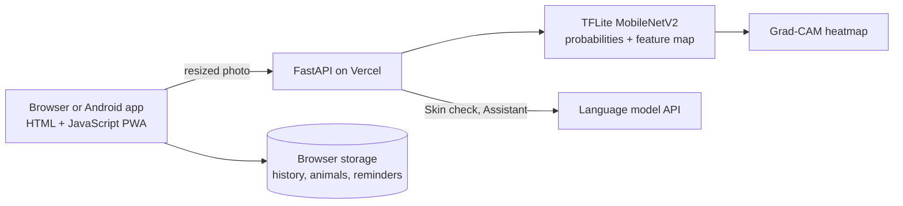

# GokulEye

*Identify cattle and buffalo from a single photo.*

[](https://gokul-eye.vercel.app)
[](https://github.com/RishiMishra06/GokulEye/releases/latest)
[](https://www.python.org/)
[](https://fastapi.tiangolo.com/)
[](https://www.tensorflow.org/lite)
[](https://github.com/RishiMishra06/GokulEye/actions)
[](LICENSE)

GokulEye is an image-based animal type classification system. Upload a photo and it tells you whether the animal is cattle or buffalo, how confident it is, and which parts of the photo it used to decide. Around the classifier sits a small toolkit for livestock owners: skin screening, a Hindi and English assistant, per-animal health records with reminders, and a vet finder with the national helpline.

**Try it:** [gokul-eye.vercel.app](https://gokul-eye.vercel.app) &nbsp;|&nbsp; **Android app:** [download the APK](https://github.com/RishiMishra06/GokulEye/releases/latest)

[](docs/classify.png) [](docs/skin.png)

[](docs/assistant-hindi.png) [](docs/dashboard.png)

[](docs/animals.png) [](docs/vets.png)

## Contents

[Features](#features) · [How it works](#how-it-works) · [Model performance](#model-performance) · [Architecture](#architecture) · [Android app](#android-app) · [Run locally](#run-locally) · [Train your own model](#train-your-own-model) · [Deploy](#deploy) · [Project structure](#project-structure) · [Tests](#tests) · [Limitations](#limitations) · [Roadmap](#roadmap) · [Author](#author)

## Features

| Area | What it does |
| --- | --- |
| **Classify** | Cattle, buffalo, or *other* (not cattle or buffalo) from one photo, with a confidence score for every class, a Grad-CAM heatmap that shows what the model looked at, a PDF report and WhatsApp sharing |
| **Batch** | Classify many photos at once and download the results as CSV |
| **Skin check** | Screens a skin photo for lumpy skin disease, ringworm, warts and mange with a risk level and advice. Photos that are not cattle or buffalo are rejected |
| **Assistant** | Livestock questions in English or Hindi, by typing or by voice, with optional read-aloud. It sees your latest result for context |
| **My animals** | Give each animal a name or tag, link classifications and skin checks to it, view its health timeline, and set your own reminders such as vaccination dates |
| **Dashboard** | Counts by type, reminders that are due, and the model's test accuracy, precision, recall and confusion matrix |
| **Find a vet** | National livestock helpline 1962 one tap away, plus a searchable vet directory with distance sorting (OpenStreetMap data) |
| **Breeds** | Reference table of common Indian and exotic cattle and buffalo breeds |
| **History** | Search, filter, delete and export your records as JSON |
| **Hindi and English** | The whole interface switches language, including voice input |
| **Installable** | Works as a PWA from the browser and as an Android app |

## How it works

- **Model:** MobileNetV2 with ImageNet weights, fine-tuned for three classes: *Buffalo*, *Cattle* and *Other*. Input is a 224 x 224 RGB photo
- **Training:** stratified 70 / 15 / 15 split, light augmentation (flip, rotation, zoom), class weights, then the last 30 layers are fine-tuned at a low learning rate
- **Other class:** photos of look-alike animals (horse and nilgai) teach the model to say "not cattle or buffalo" instead of forcing a guess
- **Explainability:** Grad-CAM is computed in closed form. For a global-average-pool plus dense softmax head, the channel weights are `W[:, c] - W @ p`, so the server needs only the last convolutional feature map and the dense weights, with no gradient tape. A unit test checks the formula against a numerical gradient
- **Inference:** the model is exported to TensorFlow Lite and run with `ai-edge-litert`, which keeps the deployment small enough for a serverless function
- **Skin check and Assistant:** these call a language model API (Google Gemini) with a safety prompt that always points to a registered veterinarian. Skin check is a screening aid, not a trained disease classifier

## Model performance

Dataset: 339 photos (Cattle 78, Buffalo 108, Other 153). Split: 237 train, 51 validation, 51 test.

| Metric | Value |
| --- | --- |
| Test accuracy | **86.3%** (44 of 51 held-out photos) |

Confusion matrix (rows are the true class, columns are the prediction):

| True \ Predicted | Buffalo | Cattle | Other |
| --- | --- | --- | --- |
| **Buffalo** | 17 | 0 | 0 |
| **Cattle** | 1 | 10 | 0 |
| **Other** | 2 | 4 | 17 |

| Class | Precision | Recall |
| --- | --- | --- |
| Buffalo | 85.0% | 100% |
| Cattle | 71.4% | 90.9% |
| Other | 100% | 73.9% |

**Read this carefully:** 51 test photos is a small test set, so one more or one fewer mistake moves the accuracy by about 2 points. The weakest spot is *Other* being mistaken for cattle (4 horse or nilgai photos), because those animals look like cattle. The metrics are produced by `backend/train.py` on photos the model never trained on and are shown live on the Dashboard tab.

## Architecture



| Endpoint | Purpose |
| --- | --- |
| `POST /api/classify` | Class probabilities and a 7 x 7 heatmap for one image |
| `POST /api/skin` | Skin screening with animal validation |
| `POST /api/chat` | Assistant reply in English or Hindi |

Requests are rate limited per IP, images are capped at 6 MB, and history stays in the user's browser.

## Android app

1. Open the [latest release](https://github.com/RishiMishra06/GokulEye/releases/latest) on your phone and download the `.apk`
2. Allow "Install unknown apps" for your browser or file manager when Android asks
3. If Play Protect warns about an unknown developer, choose **More details, then Install anyway**
4. Open GokulEye and allow camera, location and microphone when asked

The app is the web app packaged as a Trusted Web Activity, so it needs an internet connection. You can also install it straight from Chrome with **Install app**.

## Run locally

```bash
pip install -r requirements.txt
uvicorn backend.server:app --reload
```

Open http://localhost:8000. The `models/` folder must contain `gokuleye.tflite`, `head.json`, `classes.json` and `metrics.json`. Set `LLM_API_KEY` (and optionally `LLM_MODEL`) to enable Skin check and the Assistant.

## Train your own model

Arrange photos in one folder per class (`Cattle/`, `Buffalo/`, `Other/`), then train. A free Colab GPU is enough and takes a few minutes.

```bash
pip install tensorflow scikit-learn
python backend/train.py path/to/dataset 15
```

Convert the trained model to TensorFlow Lite and save the dense head weights:

```python
import tensorflow as tf, json
m = tf.keras.models.load_model('models/gokuleye.keras')
fm = tf.keras.Model(m.input, [m.get_layer('out_relu').output, m.output])
open('models/gokuleye.tflite', 'wb').write(tf.lite.TFLiteConverter.from_keras_model(fm).convert())
W, b = m.layers[-1].get_weights()
json.dump({'W': W.tolist(), 'b': b.tolist()}, open('models/head.json', 'w'))
```

## Deploy

The project deploys to [Vercel](https://vercel.com) as a single FastAPI app (`app.py` is the entry point). Import the repository, keep the root directory, and add the environment variable `LLM_API_KEY`. Every push to `main` redeploys.

## Project structure

```
app.py                  Vercel entry point
backend/server.py       FastAPI app: TFLite inference, Grad-CAM, skin check, assistant
backend/train.py        Training and evaluation (writes models/ and metrics.json)
web/index.html          Single-page interface (English and Hindi)
web/sw.js               Service worker for the PWA
web/manifest.json       PWA manifest
web/breeds.csv          Breed reference table
web/vets.csv            Vet directory
models/                 gokuleye.tflite, head.json, classes.json, metrics.json
tests/test_server.py    Unit and API tests
.github/workflows/      Continuous integration
```

## Tests

```bash
pip install pytest
python -m pytest -q
```

The tests cover input validation, the classify endpoint, rejection of non-cattle skin photos, and the Grad-CAM formula against a numerical gradient. GitHub Actions runs them on every push.

## Limitations

- The training set is small (339 photos), so accuracy is indicative and may not hold for every breed, angle or lighting condition
- Many buffalo photos in the training data show wild buffalo with large curved horns, not only Indian domestic buffalo such as Murrah. Results on Indian buffalo breeds may be weaker
- The *Other* class only contains horse and nilgai, so other animals, people or objects may still be mislabelled
- Skin check uses a language model for screening and is not a trained disease classifier. It is not a diagnosis
- The vet directory comes from OpenStreetMap, which is crowd-sourced. Coverage differs by state and many entries have no phone number. Always call to confirm that a clinic treats cattle and buffalo
- History, animals and reminders are stored in the browser, so they do not sync between devices
- GokulEye is decision support only and does not replace a registered veterinarian. For emergencies call the national livestock helpline **1962**

## Roadmap

- Breed recognition (Gir, Murrah and others) once labelled breed photos are available
- More *Other* examples (dogs, goats, people, vehicles) and more Indian buffalo photos
- Cloud sync for records
- A trained skin-disease model to replace the language-model screening

## Tech stack

Python · FastAPI · TensorFlow and TensorFlow Lite (MobileNetV2) · NumPy · Pillow · JavaScript (PWA) · Google Gemini API · PWABuilder (Android package) · Vercel · pytest · GitHub Actions

## Data credits

- Training photos: a public Kaggle image dataset with cow, water buffalo, nilgai and horse folders
- Vet directory: © [OpenStreetMap](https://www.openstreetmap.org/copyright) contributors, available under the ODbL
- Breed table: a public breed information CSV from Kaggle

## Author

**Rishi Mishra** · [github.com/RishiMishra06](https://github.com/RishiMishra06)

## License

MIT, see [LICENSE](LICENSE).
